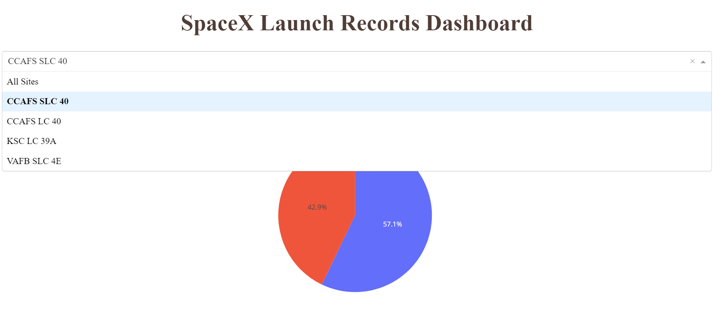
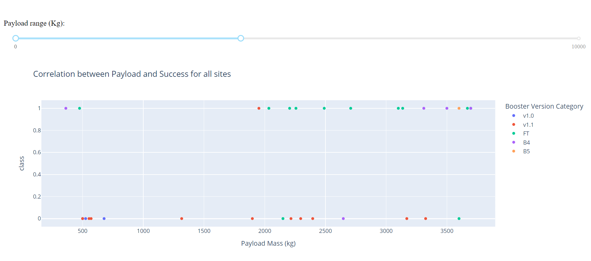

# Falcon 9 First-Stage Landing Prediction

An end-to-end data science project that predicts whether a SpaceX Falcon 9 first stage will land successfully. Since SpaceX advertises Falcon 9 launches at about $62M versus $165M+ for competitors (largely because the first stage can be reused), predicting landing success helps estimate the cost of a launch.

The project covers the full workflow: data collection, wrangling, exploratory analysis (SQL and visualization), geographic analysis, an interactive dashboard, and machine-learning classification.

## Project Structure

| File | Description |
|------|-------------|
| `data-collection-api.ipynb` | Collects launch data from the SpaceX REST API |
| `data-collection-webscraping.ipynb` | Scrapes Falcon 9 launch records from Wikipedia with BeautifulSoup |
| `data-wrangling.ipynb` | Cleans the data and builds the binary landing-outcome label (`class`) |
| `EDA-using-SQL.ipynb` | Exploratory analysis with SQL queries on SQLite |
| `EDA-visualization.ipynb` | Exploratory analysis and feature engineering with pandas, matplotlib and seaborn |
| `visual-analytics-folium-maps.ipynb` | Interactive launch-site maps with Folium |
| `spacex_dash_app.py` | Plotly Dash dashboard for launch success records |
| `ML-prediction.ipynb` | Trains and tunes classification models to predict landing success |
| `Dashboard/` | Screenshots of the dashboard (`Pie.png`, `Scatter.png`) |

## Methodology

1. **Data collection**: the SpaceX API and web scraping provide launch, booster, payload and landing data.
2. **Data wrangling**: landing outcomes are converted to a binary class (1 = success, 0 = failure).
3. **EDA**: SQL queries and visualizations explore launch sites, payload mass, orbit type, flight number and success rate.
4. **Geospatial analysis**: Folium maps show launch sites and their proximity to coastlines, railways, highways and cities.
5. **Dashboard**: Plotly Dash shows success counts by launch site and the relationship between payload mass and outcome.
6. **Modeling**: four classifiers are tuned with `GridSearchCV` (10-fold cross-validation) and compared on a held-out test set:
   - Logistic Regression
   - Support Vector Machine
   - Decision Tree
   - K-Nearest Neighbors

   Results are evaluated by accuracy and confusion matrices.

## Dashboard

`spacex_dash_app.py` provides:

- A launch-site dropdown (All Sites, CCAFS SLC-40, CCAFS LC-40, KSC LC-39A, VAFB SLC-4E)
- A pie chart of successful launches, either by site or success vs. failure for one site
- A payload range slider
- A scatter plot of payload mass against launch outcome, colored by booster version category

Screenshots are in the `Dashboard/` folder.




## Getting Started

### Prerequisites

- Python 3.8+
- Jupyter Notebook or JupyterLab

```bash
pip install pandas numpy matplotlib seaborn scikit-learn requests beautifulsoup4 folium dash plotly jupyter
```

The dashboard uses the `dash_html_components` and `dash_core_components` packages, so it needs Dash 1.x or 2.x (these were removed in Dash 3). With newer Dash versions, change those imports to `from dash import html, dcc`.

### Running the notebooks

Run them in this order:

1. `data-collection-api.ipynb`
2. `data-collection-webscraping.ipynb`
3. `data-wrangling.ipynb`
4. `EDA-using-SQL.ipynb`
5. `EDA-visualization.ipynb`
6. `visual-analytics-folium-maps.ipynb`
7. `ML-prediction.ipynb`

Several notebooks download their datasets from hosted CSV URLs, so an internet connection is required. Some cells were written for the JupyterLite environment (`piplite`, `js.fetch`) and may need small changes to run in a local Jupyter setup.

### Running the dashboard

Download `spacex_launch_dash.csv` and place it in the project root, then run:

```bash
python spacex_dash_app.py
```

Open http://127.0.0.1:8050 in your browser.

## Tech Stack

Python, pandas, NumPy, scikit-learn, SQLite, matplotlib, seaborn, Folium, Plotly Dash, BeautifulSoup, Requests

## Acknowledgements

This project was developed as part of the IBM Data Science Professional Certificate capstone (Skills Network labs).
